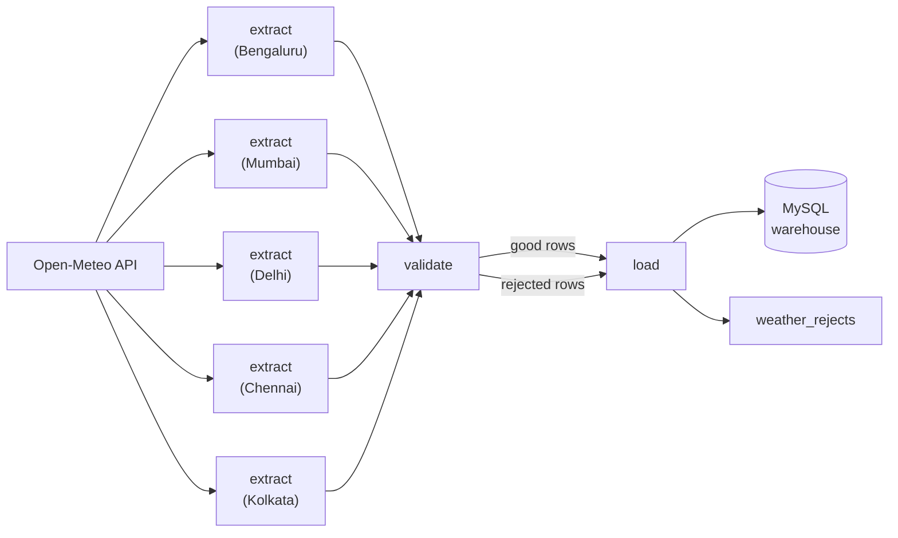

# SkySnap — Indian Weather Data Pipeline

SkySnap is a daily data pipeline that collects hourly weather for five Indian cities, validates it and stores it in a queryable warehouse. Built with Apache Airflow 3, MySQL 8, Docker Compose and the Open-Meteo API.

A daily [Apache Airflow 3](https://airflow.apache.org/) pipeline that pulls yesterday's **hourly weather** for **5 Indian cities** from the [Open-Meteo](https://open-meteo.com/) API, quarantines bad rows, and upserts the rest into a **MySQL 8** warehouse — runnable with a single `docker compose up`.

---

## Architecture



**Design principles:**
- All business logic lives in `src/weather_etl` — a plain Python package that **never imports Airflow**.
- The DAG (`dags/weather_etl.py`) is thin wiring only, using Airflow's TaskFlow API.
- Idempotent schema (`CREATE TABLE IF NOT EXISTS`, `INSERT IGNORE`, `ON DUPLICATE KEY UPDATE`).

---

## Quick Start

```bash
# 1. Clone and enter the project
git clone https://github.com/Rehan038/skysnap-weather-pipeline.git
cd skysnap-weather-pipeline

# 2. Create the environment file
cp .env.example .env
# Edit .env and set MYSQL_ROOT_PASSWORD

# 3. Build and start the full stack
docker compose up -d --build

# 4. Wait ~60 s for all services to be healthy, then open the Airflow UI
open http://localhost:8080
# No login is required: SIMPLE_AUTH_MANAGER_ALL_ADMINS signs you in automatically

# 5. Unpause the DAG in the UI — catchup runs will start from 2026-10-01
```

> **Note:** `AIRFLOW__CORE__SIMPLE_AUTH_MANAGER_ALL_ADMINS: "true"` is set for local development only. For production deployments, configure proper authentication. See [Airflow security docs](https://airflow.apache.org/docs/apache-airflow/stable/security/index.html).

---

## Backfill

To (re-)run a date range from the scheduler container:

```bash
docker compose exec airflow-scheduler \
  airflow backfill create \
    --dag-id weather_etl \
    --from-date 2026-10-01 \
    --to-date 2026-10-31
```

---

## Running Tests Locally

```bash
# Create a virtual environment
python -m venv .venv
source .venv/bin/activate   # Windows: .venv\Scripts\activate

# Install dev dependencies
pip install -r requirements-dev.txt

# Run unit tests (no MySQL needed — load tests are auto-skipped)
pytest -v

# With MySQL running in Docker (exposed on host port 3307), all tests including load tests run:
TEST_WAREHOUSE_PORT=3307 TEST_WAREHOUSE_DB=weather_test pytest -v

# Note: Tests connect to `weather_test` on host port 3307 (default WAREHOUSE_HOST_PORT).
# The pipeline inside Docker continues using `warehouse:3306` and the production `weather` database.
# Tests will fail immediately with a safety check error if TEST_WAREHOUSE_DB does not end with `_test`.

# Lint
ruff check .
```

---

## Data Model

```
dim_city
  city_id   SMALLINT PK
  name      VARCHAR(64) UNIQUE
  state     VARCHAR(64)
  latitude  DECIMAL(8,5)
  longitude DECIMAL(8,5)

weather_hourly
  city_id          SMALLINT FK → dim_city
  observed_at      DATETIME
  temperature_c    DECIMAL(5,2)
  humidity_pct     DECIMAL(5,2)
  precipitation_mm DECIMAL(6,2)
  wind_kmh         DECIMAL(6,2)
  weather_code     SMALLINT
  run_date         DATE
  PRIMARY KEY (city_id, observed_at)

weather_rejects
  id          BIGINT PK AUTO_INCREMENT
  city        VARCHAR(64)
  observed_at DATETIME (nullable)
  raw_row     JSON
  reason      VARCHAR(255)
  run_date    DATE
```

---

## Example Queries

### 1. Daily max temperature per city — last 7 days

```sql
SELECT
    c.name                          AS city,
    DATE(h.observed_at)             AS day,
    MAX(h.temperature_c)            AS max_temp_c
FROM weather_hourly h
JOIN dim_city c USING (city_id)
WHERE h.observed_at >= CURDATE() - INTERVAL 7 DAY
GROUP BY c.name, DATE(h.observed_at)
ORDER BY day DESC, city;
```

**Output:**
```
city        day         max_temp_c
Bengaluru   2026-11-02  26.50
Chennai     2026-11-02  26.70
Delhi       2026-11-02  29.20
Kolkata     2026-11-02  31.30
Mumbai      2026-11-02  34.30
Bengaluru   2026-11-01  29.50
Chennai     2026-11-01  30.90
Delhi       2026-11-01  28.40
Kolkata     2026-11-01  30.90
Mumbai      2026-11-01  33.20
...
```

### 2. Rainiest city last week

```sql
SELECT
    c.name                          AS city,
    SUM(h.precipitation_mm)         AS total_precipitation_mm
FROM weather_hourly h
JOIN dim_city c USING (city_id)
WHERE h.observed_at >= CURDATE() - INTERVAL 7 DAY
GROUP BY c.name
ORDER BY total_precipitation_mm DESC
LIMIT 1;
```

**Output:**
```
city    total_precipitation_mm
Delhi   81.60
```

> **Note:** Delhi's total comes from two heavy days (2026-10-29: 41.2 mm, 2026-10-30: 40.2 mm). Both daily sums were cross-checked against the Open-Meteo API and match exactly. Values are modelled grid data, not station readings.

### 3. Hourly average temperature profile for Bengaluru (by hour of day)

```sql
SELECT
    HOUR(h.observed_at)             AS hour_of_day,
    ROUND(AVG(h.temperature_c), 2)  AS avg_temp_c
FROM weather_hourly h
JOIN dim_city c USING (city_id)
WHERE c.name = 'Bengaluru'
GROUP BY HOUR(h.observed_at)
ORDER BY hour_of_day;
```

**Output:**
```
hour_of_day  avg_temp_c
0            21.59
1            21.18
2            20.83
3            20.55
4            20.34
5            20.67
6            20.46
7            21.46
8            23.11
9            24.78
10           26.20
11           27.29
12           27.79
13           28.33
14           28.22
15           27.95
16           27.07
17           26.33
18           24.75
19           24.01
20           23.37
21           22.83
22           22.33
23           22.24
```

### 4. Rejects by reason

```sql
SELECT reason, COUNT(*) AS cnt
FROM weather_rejects
GROUP BY reason
ORDER BY cnt DESC;
```

**Output:**
```
Empty set (0 rows) — all rows passed validation checks.
```

---

## Design Decisions

| Decision | Rationale |
|---|---|
| Open-Meteo (free tier) | No API key required; supports historical hourly data for Indian cities |
| LocalExecutor | Simplifies local development — no Redis/Celery needed |
| `ON DUPLICATE KEY UPDATE` | Idempotent upserts make re-runs safe without extra deduplication logic |
| `DELETE + INSERT` for rejects | Rejects are replaced per `run_date` so re-runs don't accumulate duplicates |
| `src` layout | Keeps `weather_etl` importable by pytest and the DAG without Airflow in the path |
| `weather_code` nullable | It's a WMO label, not a measurement — missing values are acceptable |

---

## Limitations

- **Open-Meteo Forecast API 92-day window:** The free forecast endpoint only serves data within ~92 days of the current date. Dates older than that will return empty or error responses. Use the [ERA5 historical API](https://open-meteo.com/en/docs/historical-weather-api) for long backfills.
- **Gridded model data, not station readings:** Temperatures and precipitation are interpolated from weather models, not measured at a physical station — they may differ from local observations.
- **`SIMPLE_AUTH_MANAGER_ALL_ADMINS`:** This setting grants all users admin access and is suitable for local development only. Do not use in production.

- **Airflow JWT secret:** The default `AIRFLOW__API_AUTH__JWT_SECRET` in `docker-compose.yml` is a local-development placeholder. Override it (via `.env`) in any real deployment.

---

## License

Released under the [MIT License](LICENSE).
