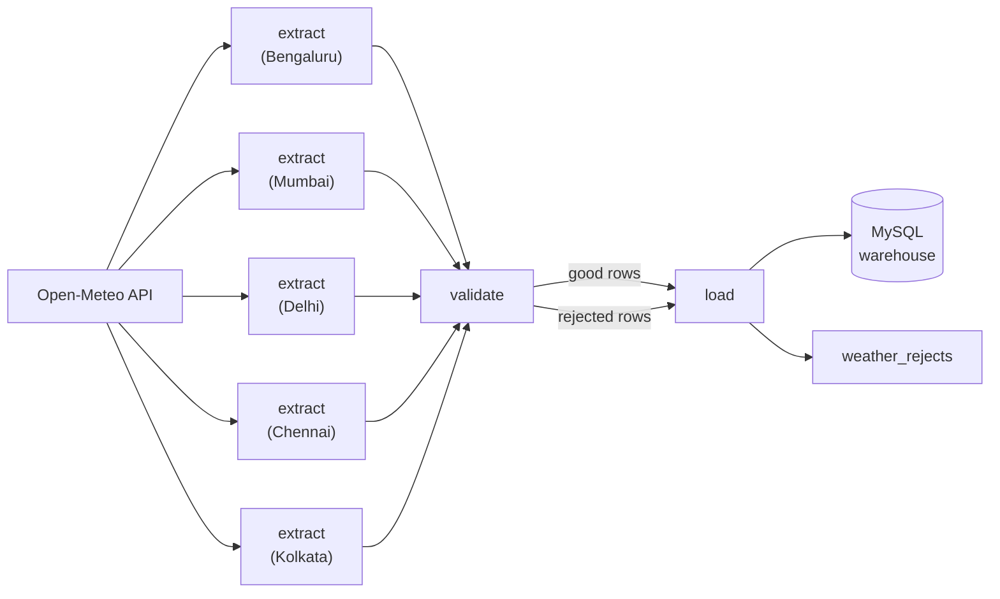
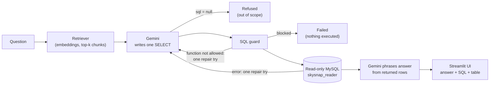
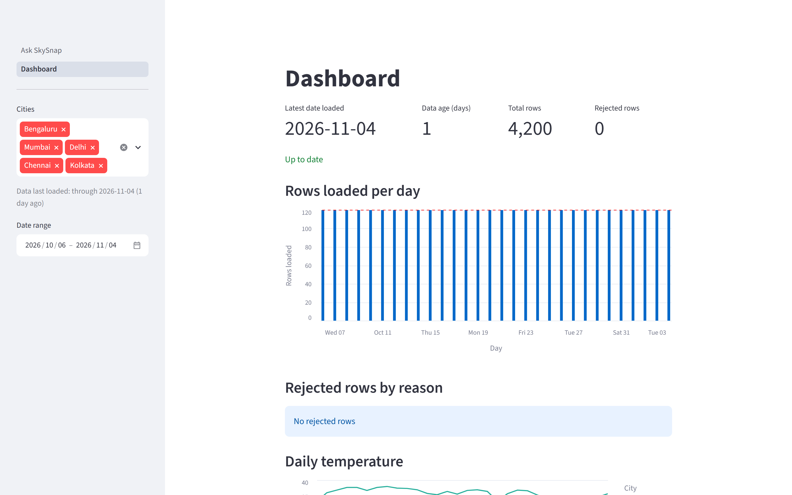

# SkySnap — Indian Weather Data Pipeline

[](https://github.com/Rehan038/skysnap-weather-pipeline/actions/workflows/ci.yml)

SkySnap is a daily data pipeline that collects hourly weather for five Indian cities, validates it and stores it in a queryable warehouse. Built with Apache Airflow 3, MySQL 8, Docker Compose and the Open-Meteo API.

A daily [Apache Airflow 3](https://airflow.apache.org/) pipeline that pulls yesterday's **hourly weather** for **5 Indian cities** from the [Open-Meteo](https://open-meteo.com/) API, quarantines bad rows, and upserts the rest into a **MySQL 8** warehouse — runnable with a single `docker compose up`.

---

## Architecture



**Design principles:**
- All business logic lives in `src/weather_etl` — a plain Python package that **never imports Airflow**.
- The DAG (`dags/weather_etl.py`) is thin wiring only, using Airflow's TaskFlow API.
- Idempotent schema (`CREATE TABLE IF NOT EXISTS`, `INSERT IGNORE`, `ON DUPLICATE KEY UPDATE`).

---

## Quick Start

```bash
# 1. Clone and enter the project
git clone https://github.com/Rehan038/skysnap-weather-pipeline.git
cd skysnap-weather-pipeline

# 2. Create the environment file
cp .env.example .env
# Edit .env and fill in every empty password / secret: MYSQL_ROOT_PASSWORD, MYSQL_PASSWORD,
# POSTGRES_PASSWORD, SKYSNAP_READER_PASSWORD, AIRFLOW__API_AUTH__JWT_SECRET.
# There are no built-in defaults: docker compose refuses to start while one is missing.

# 3. Build and start the full stack
docker compose up -d --build

# 4. Wait ~60 s for all services to be healthy, then open the Airflow UI
open http://localhost:8080
# No login is required: SIMPLE_AUTH_MANAGER_ALL_ADMINS signs you in automatically

# 5. Unpause the DAG in the UI — catchup runs will start from 2026-10-01
```

> **Network exposure:** every published port (Airflow `8080`, Streamlit `8501`, MySQL `3307`) is bound to `127.0.0.1`, so the stack is reachable only from the machine running it. Airflow has no login and the Streamlit app can spend Gemini quota, so do not publish them on `0.0.0.0` or a shared network without adding authentication.
>
> **Database accounts:** `weather` (the pipeline) has only `SELECT, INSERT, UPDATE, DELETE` on the `weather` schema (`sql/03-pipeline-grants.sh`; it keeps `ALL` on `weather_test` for the test-suite). `skysnap_reader` (used by Ask SkySnap and the Dashboard) has `SELECT` on only `dim_city`, `weather_hourly` and `weather_rejects`, and at most 10 concurrent connections (`sql/02-reader-user.sh`, which also re-applies the password, so it can be rotated). To apply either script to an existing warehouse volume: `docker compose exec warehouse sh /docker-entrypoint-initdb.d/02-reader-user.sh` and `docker compose exec warehouse sh /docker-entrypoint-initdb.d/03-pipeline-grants.sh`.
>
> **Existing volumes:** an existing MySQL/Postgres volume keeps the passwords it was created with, so set `MYSQL_PASSWORD` and `POSTGRES_PASSWORD` in `.env` to those old values (or recreate the volumes, which deletes the data).
>
> **Note:** `AIRFLOW__CORE__SIMPLE_AUTH_MANAGER_ALL_ADMINS: "true"` is set for local development only. For production deployments, configure proper authentication. See [Airflow security docs](https://airflow.apache.org/docs/apache-airflow/stable/security/index.html).

---

## Backfill

To (re-)run a date range from the scheduler container:

```bash
docker compose exec airflow-scheduler \
  airflow backfill create \
    --dag-id weather_etl \
    --from-date 2026-10-01 \
    --to-date 2026-10-31
```

---

## Running Tests Locally

```bash
# Create a virtual environment
python -m venv .venv
source .venv/bin/activate   # Windows: .venv\Scripts\activate

# Install dev dependencies
pip install -r requirements-dev.txt

# Run unit tests (no MySQL needed — load tests are auto-skipped)
pytest -v

# With MySQL running in Docker (exposed on host port 3307), all tests including load tests run:
TEST_WAREHOUSE_PORT=3307 TEST_WAREHOUSE_DB=weather_test pytest -v

# Note: Tests connect to `weather_test` on host port 3307 (default WAREHOUSE_HOST_PORT).
# The pipeline inside Docker continues using `warehouse:3306` and the production `weather` database.
# Tests will fail immediately with a safety check error if TEST_WAREHOUSE_DB does not end with `_test`.

# Lint
ruff check .
```

---

## Data Model

```
dim_city
  city_id   SMALLINT PK
  name      VARCHAR(64) UNIQUE
  state     VARCHAR(64)
  latitude  DECIMAL(8,5)
  longitude DECIMAL(8,5)

weather_hourly
  city_id          SMALLINT FK → dim_city
  observed_at      DATETIME
  temperature_c    DECIMAL(5,2)
  humidity_pct     DECIMAL(5,2)
  precipitation_mm DECIMAL(6,2)
  wind_kmh         DECIMAL(6,2)
  weather_code     SMALLINT
  run_date         DATE
  PRIMARY KEY (city_id, observed_at)

weather_rejects
  id          BIGINT PK AUTO_INCREMENT
  city        VARCHAR(64)
  observed_at DATETIME (nullable)
  raw_row     JSON
  reason      VARCHAR(255)
  run_date    DATE
```

---

## Example Queries

### 1. Daily max temperature per city — last 7 days

```sql
SELECT
    c.name                          AS city,
    DATE(h.observed_at)             AS day,
    MAX(h.temperature_c)            AS max_temp_c
FROM weather_hourly h
JOIN dim_city c USING (city_id)
WHERE h.observed_at >= CURDATE() - INTERVAL 7 DAY
GROUP BY c.name, DATE(h.observed_at)
ORDER BY day DESC, city;
```

**Output:**
```
city        day         max_temp_c
Bengaluru   2026-11-02  26.50
Chennai     2026-11-02  26.70
Delhi       2026-11-02  29.20
Kolkata     2026-11-02  31.30
Mumbai      2026-11-02  34.30
Bengaluru   2026-11-01  29.50
Chennai     2026-11-01  30.90
Delhi       2026-11-01  28.40
Kolkata     2026-11-01  30.90
Mumbai      2026-11-01  33.20
...
```

### 2. Rainiest city last week

```sql
SELECT
    c.name                          AS city,
    SUM(h.precipitation_mm)         AS total_precipitation_mm
FROM weather_hourly h
JOIN dim_city c USING (city_id)
WHERE h.observed_at >= CURDATE() - INTERVAL 7 DAY
GROUP BY c.name
ORDER BY total_precipitation_mm DESC
LIMIT 1;
```

**Output:**
```
city    total_precipitation_mm
Delhi   81.60
```

> **Note:** Delhi's total comes from two heavy days (2026-10-29: 41.2 mm, 2026-10-30: 40.2 mm). Both daily sums were cross-checked against the Open-Meteo API and match exactly. Values are modelled grid data, not station readings.

### 3. Hourly average temperature profile for Bengaluru (by hour of day)

```sql
SELECT
    HOUR(h.observed_at)             AS hour_of_day,
    ROUND(AVG(h.temperature_c), 2)  AS avg_temp_c
FROM weather_hourly h
JOIN dim_city c USING (city_id)
WHERE c.name = 'Bengaluru'
GROUP BY HOUR(h.observed_at)
ORDER BY hour_of_day;
```

**Output:**
```
hour_of_day  avg_temp_c
0            21.59
1            21.18
2            20.83
3            20.55
4            20.34
5            20.67
6            20.46
7            21.46
8            23.11
9            24.78
10           26.20
11           27.29
12           27.79
13           28.33
14           28.22
15           27.95
16           27.07
17           26.33
18           24.75
19           24.01
20           23.37
21           22.83
22           22.33
23           22.24
```

### 4. Rejects by reason

```sql
SELECT reason, COUNT(*) AS cnt
FROM weather_rejects
GROUP BY reason
ORDER BY cnt DESC;
```

**Output:**
```
Empty set (0 rows) — all rows passed validation checks.
```

---

## Ask SkySnap

Ask SkySnap lets you question the warehouse in plain English ("Which city had the most rain between 2026-10-01 and 2026-10-07?"). It is a retrieval-augmented **text-to-SQL** assistant: Gemini writes a single SQL query, MySQL computes the numbers, and Gemini phrases the answer from the rows MySQL returned. The model never does arithmetic on raw data and the SQL is always shown, so every answer can be checked.

**Why text-to-SQL and not RAG over rows?** The data is numeric and relational. Embedding thousands of hourly rows would make the model guess at aggregates; asking it for SQL keeps the maths in the database. Retrieval is used for something small and useful instead: a ~20-chunk knowledge base (table docs, conventions such as "`observed_at` is IST" and example question-to-SQL pairs) is searched by embedding similarity and put in the prompt.



### Safety layers

1. **SQL guard** (`src/skysnap_ask/guard.py`, built on `sqlglot`): at most 10,000 characters; exactly one statement; only `SELECT` (or a `UNION` of selects); no `INTO`, no locking reads (`FOR UPDATE`, `FOR SHARE`), no optimizer hints, no `@@` system variables; only the tables `dim_city`, `weather_hourly`, `weather_rejects` (CTE names are fine); a `LIMIT` of at most 200 rows is added or enforced.
2. **Function allow-list**: only aggregates (`COUNT`, `SUM`, `AVG`, `MIN`, `MAX`, `STDDEV`, `VARIANCE`), date and time functions (`DATE`, `HOUR`, `DAY`, `MONTH`, `YEAR`, `DATE_FORMAT`, `DATE_ADD`, `DATE_SUB`, `DAYNAME`, `MONTHNAME`, `DAYOFWEEK`, `WEEK`, `QUARTER`, `CURDATE`, `NOW`, `TIMESTAMPDIFF`, `DATEDIFF`, `EXTRACT` and a few more), `ROUND`/`ABS`/`FLOOR`/`CEIL`/`LEAST`/`GREATEST`, `COALESCE`/`IFNULL`/`NULLIF`/`IF`/`CASE`/`CAST`, and `CONCAT`/`LOWER`/`UPPER`. Anything else is refused (`SLEEP`, `GET_LOCK`, `USER`, `VERSION` and friends immediately; other functions after one repair attempt). The list lives in one constant (`ALLOWED_FUNCTIONS`), and the prompt shown to the model is generated from it, so the two cannot drift apart.
3. **Read-only database account**: queries run as `skysnap_reader`, which has `SELECT` on `dim_city`, `weather_hourly` and `weather_rejects` only (not the whole schema), at most 10 connections, and cannot change data even if SQL slipped past the guard.
4. **Time limit**: every query runs with `MAX_EXECUTION_TIME = 5000` ms.
5. **Safe display**: model text is shown as plain text (no live links, images or HTML), and database errors are shown as a generic message plus the MySQL error code; the full detail goes to the server log only.

Failures are bounded: a question gets at most one repair attempt, either after a MySQL error (the error, with account and host names removed, is fed back to the model) or after a non-allowed function; then a clear failure message. Gemini rate limits (HTTP 429/503) are retried with exponential backoff, then reported as "temporarily unavailable"; the app does not crash.

### Setup

```bash
# 1. Get a Gemini API key from Google AI Studio (https://aistudio.google.com/)
# 2. In .env set (see .env.example):
#      GEMINI_API_KEY=...            (never commit this file)
#      GEMINI_MODEL=gemini-3.5-flash
#      GEMINI_EMBED_MODEL=gemini-embedding-001
#      SKYSNAP_READER_PASSWORD=...   (any strong password for the read-only account; required)
#    plus the other required variables listed in Quick Start (there are no default passwords)
docker compose up -d --build
# 3. Open http://localhost:8501
```

The reader account is created automatically the first time the warehouse volume is initialised. On an **existing** volume, create it once with:

```bash
docker compose up -d warehouse
docker compose exec warehouse sh /docker-entrypoint-initdb.d/02-reader-user.sh
# Git Bash on Windows rewrites the path; prefix the command with MSYS_NO_PATHCONV=1
```

The first page load embeds the knowledge base (one Gemini embedding call) and caches it in the `ask-cache` volume.

### Testing

| Tier | What | Network |
|---|---|---|
| Unit | guard, prompts, retriever, LLM wrapper retries, service flows, config, UI (`streamlit.testing`), eval comparison, all with fakes | none |
| MySQL integration | the reader account can `SELECT` but not write; execution limit; error wrapping | local DB only |
| Real-API smoke and acceptance | one real text and embedding call; four manual UI scenarios (answer, destructive request, out-of-scope, database down) | Gemini, run by hand |
| Evaluation | 10 held-out questions, see below | Gemini, run by hand |

CI runs the first two tiers with no Gemini calls (`ask` job, coverage gate 85%).

### Evaluation

`scripts/eval_ask.py` asks 10 held-out questions (`eval/questions.yaml`, absolute dates in October 2026, none reused from the knowledge base) and compares the generated query's result set with a hand-written reference query. Cells are rounded to one decimal place and compared as sorted tuples, so column order, aliases and tiny float noise do not matter; the one out-of-scope question passes only if the app refuses. Questions that hit a Gemini rate limit are retried and, if still unavailable, excluded and counted separately. **Score measures SQL result correctness; answer phrasing is not evaluated.**

- Text model: `gemini-3.5-flash`, embedding model: `gemini-embedding-001`
- Score: **EVAL_SCORE_PLACEHOLDER** (details in [`eval/last_run.md`](eval/last_run.md))

<!-- SCREENSHOT_PLACEHOLDER: docs/img/ask-answer.png (an answered question with SQL and table) -->
<!-- SCREENSHOT_PLACEHOLDER: docs/img/ask-refused.png (a refused or blocked request) -->

### Ask SkySnap limitations

- Gemini free tier allows ~20 text requests/day; each question uses 1-3 calls.
- Questions are limited to 1,000 characters and generated SQL to 10,000 characters; both are checked before anything expensive runs.
- The model may only use the allow-listed SQL functions above (no window functions, no `GROUP_CONCAT`, no string slicing such as `SUBSTRING`); a question that needs one is repaired once or refused.
- The reader account can only read `dim_city`, `weather_hourly` and `weather_rejects`.
- LLM-generated SQL can still be semantically wrong; the evaluation score quantifies this.
- On the Gemini free tier, Google may use prompts to improve its products. Only public weather data and the question text are sent.

---

## Failure Handling

Each task retries 3 times with exponential backoff (`retry_delay` 2 minutes, doubling per attempt). This was verified inside Airflow, not just in Python: with the API URL pointed at a dead address, all 5 per-city `extract` tasks failed with `Connection refused`, retried 3 more times (gaps of roughly 5, 13 and 27 minutes in the observed run, because Airflow adds jitter to the backoff), then ended `failed`; `validate` and `load` became `upstream_failed`. The failed run wrote nothing, and the previously loaded rows (24 per city for 2026-10-10) were unchanged. After restoring the real URL and clearing the run, it finished `success` with the same 24 rows per city.

## Dashboard

The Streamlit app at http://localhost:8501 has two pages in its sidebar: **Ask SkySnap** and **Dashboard**. The Dashboard is plain analytics over the warehouse: fixed, parameterised SQL run as the read-only `skysnap_reader` account, no LLM and no user-written SQL.

**Pipeline health (top of the page)**
- Tiles: latest date loaded, data age in days, total rows and rejected rows.
- Freshness colour: age 0-1 days is green, 2-3 amber, more than 3 red (no data is red). The pipeline loads the previous day at 06:00 IST, so before that run each day the age is measured from yesterday (on-schedule data stays green overnight). The tile always shows the plain age against today's date in India (`Asia/Kolkata`).
- Rows loaded per day (one bar per day with a reference line at 120 = 5 cities x 24 hours) and rejected rows by reason, or "No rejected rows".

**Charts** (all respect the sidebar filters)
1. Daily maximum (solid) and minimum (dashed) temperature per city.
2. Daily rainfall per city, as grouped bars.
3. Average temperature by hour of day (0-23) per city.
4. Humidity distribution per city, as a box plot of the hourly values.

**Filters:** city multi-select (all five by default) and a date range (the last 30 days of available data by default, limited to the dates in the database). The sidebar also shows when data was last loaded. Results are cached for 10 minutes.



[Full page](docs/img/dashboard.png)

How it is built: `src/skysnap_dash/` holds the query builders (`%s` placeholders with a fixed city allow-list), the data source, the chart builders and the freshness rules; `app/dashboard_page.py` is layout only. Tests use fakes for the UI and seeded `weather_test` data for the SQL, and CI runs them with the same 85% coverage gate as Ask SkySnap.

Dashboard limitations: values are modelled grid data, not station readings; the page is a snapshot cached for 10 minutes with no auto-refresh; "Data last loaded" shows the latest observed day, because the pipeline stores the day it loaded and not a wall-clock load time; the humidity box plot loads up to 50,000 hourly values and warns if a range hits that cap.

---

## Design Decisions

| Decision | Rationale |
|---|---|
| Open-Meteo (free tier) | No API key required; supports historical hourly data for Indian cities |
| LocalExecutor | Simplifies local development — no Redis/Celery needed |
| `ON DUPLICATE KEY UPDATE` | Idempotent upserts make re-runs safe without extra deduplication logic |
| `DELETE + INSERT` for rejects | Rejects are replaced per `run_date` so re-runs don't accumulate duplicates |
| Replace the day on re-run | The load deletes the day's rows for the batch's cities before upserting, so an hour that was good once but is rejected now cannot linger as a stale "good" row |
| Strict payloads | A response that is not exactly 24 unique, aligned hourly values per city fails the run (and is retried) instead of loading a partial day; every city must be present before load |
| Value limits | Temperature -10..55 degC, humidity 0..100 %, precipitation 0..400 mm/h, wind 0..400 km/h (all far beyond real readings); NaN and infinity are rejected explicitly |
| `src` layout | Keeps `weather_etl` importable by pytest and the DAG without Airflow in the path |
| `weather_code` nullable | It's a WMO label, not a measurement — missing values are acceptable |

---

## Limitations

- **Open-Meteo Forecast API 92-day window:** The free forecast endpoint only serves data within ~92 days of the current date. Dates older than that will return empty or error responses. Use the [ERA5 historical API](https://open-meteo.com/en/docs/historical-weather-api) for long backfills.
- **Gridded model data, not station readings:** Temperatures and precipitation are interpolated from weather models, not measured at a physical station — they may differ from local observations.
- **`SIMPLE_AUTH_MANAGER_ALL_ADMINS`:** This setting grants all users admin access and is suitable for local development only. Do not use in production.

- **Airflow JWT secret:** `AIRFLOW__API_AUTH__JWT_SECRET` is required in `.env` (no default). Use a long random value.

---

## License

Released under the [MIT License](LICENSE).
